## Question 1: Theoretical Questions [30 points]

### [2 points] Question 1.1

Let us define the L11 language as L1 excluding the special form `define`. Is there a program in L1 which cannot be transformed to an equivalent program in L11? Explain or give a contradictory example

**Answer (handwritten):** see also `HW2Q1.pdf` / `HW2Q1.1.png`.

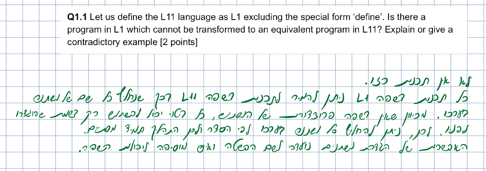

**Answer (typed):**

לא אין תכנית כזו.

כל תכנית בשפה L1 ניתן להמיר לתכנית בשפה L11 בכך שנחליף כל שם של משתנה בערכו. מכיוון שאין בשפה פרוצדורות של המשתמש, כל ביטוי יכול להשתמש רק בשמות שהוגדרו לפניו. לכן, ניתן להחליף כל משתנה בערכו לפי הסדר ולכן התהליך תמיד מסתיים.

האפשרות של הגדרת משתנים נועדה לשם הפשטה ואינה מוסיפה ליכולות השפה.

### [2 points] Question 1.2

Let us define the L21 language as L2 excluding the special form `define`. Is there a program in L2 which cannot be transformed to an equivalent program in L21? Explain or give a contradictory example

**Answer (handwritten):** see also `HW2Q1.pdf` / `HW2Q1.2.png`.

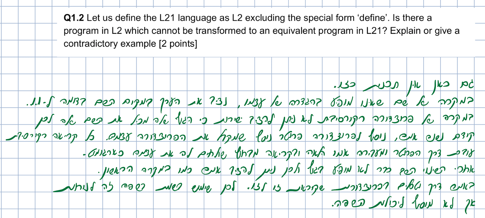

**Answer (typed):**

גם כאן אין תכנית כזו.

במקרה של שם שאינו מופיע בהגדרה של עצמו, נציב את הערך במקום השם בדומה ל-1.1.

במקרה של פרוצדורה רקורסיבית לא ניתן להציב ישירות כי הגוף שלה מכיל את השם שלה לכן קודם נשנה אותה, נוסיף לפרוצדורה פרמטר נוסף שמקבל את הפרוצדורה עצמה. כל קריאה רקורסיבית עוברת דרך הפרמטר ומעבירה אותו הלאה ובקריאה מבחוץ שולחים לה את עצמה כארגומנט.

אחרי השינוי השם כבר לא מופיע בגוף ולכן ניתן להציב אותה כמו במקרה הראשון.

באותה דרך מטפלים בפרוצדורות שקוראות זו לזו. לכן שימוש בשמות בשפה זה לנוחות אך לא מוסיף ליכולות השפה.

### [2 points] Question 1.3

Let us define the L22 language as L2, where procedures (`lambda`) can only have one parameter and a body with one expression. Is there a program in L2 which cannot be transformed to an equivalent program in L22? Explain or give a contradictory example

**Answer (handwritten):** see also `HW2Q1.pdf` / `HW2Q1.3.png`.

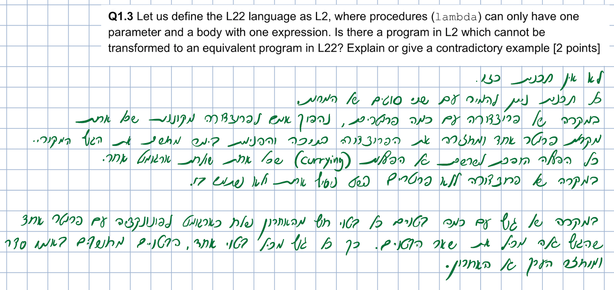

**Answer (typed):**

לא אין תכנית כזו.

כל תכנית ניתן להמיר עם שני סוגים של המרות.

במקרה של פרוצדורה עם כמה פרמטרים, נהפוך אותה לפרוצדורות מקוננות שכל אחת מקבלת פרמטר אחד ומחזירה את הפרוצדורה בתוכה והפנימית ביותר מחשבת את הגוף המקורי. כל הפעלה הופכת לשרשרת של הפעלות ‏(currying‏)‏ שכל אחת שולחת ארגומנט אחד.

במקרה של פרוצדורה ללא פרמטרים בכלל נוסיף אחד ולא נשתמש בו.

במקרה של גוף עם כמה ביטויים כל ביטוי חוץ מהאחרון נשלח כארגומנט לפונקציה עם פרמטר אחד שהגוף שלה מכיל את שאר הביטויים. כך כל גוף מכיל ביטוי אחד, הביטויים מחושבים באותו סדר ומתקבל הערך של האחרון.

### [2 points] Question 1.4

Let us define the L23 language as L2, where procedures (`lambda`) are first-order, _i.e._ cannot get functions as arguments. Is there a program in L2 which cannot be transformed to an equivalent program in L23? Explain or give a contradictory example

**Answer (handwritten):** see also `HW2Q1.pdf` / `HW2Q1.4.png`.

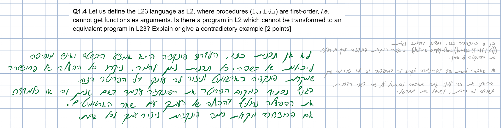

**Answer (typed):**

לא אין תכנית כזו, העברת פונקציה היא אמצעי הפשטה ואינה מוסיפה ליכולות של השפה. כל תכנית ניתן להמיר, ניקח כל הפעלה של פרוצדורה שמקבלת פונקציה כארגומנט וניצור לה עותק בלי הפרמטר הזה.

בגוף נכתוב במקום הפרמטר את הפונקציה עצמה בשם שניתן לה או כלמבדה.

את ההפעלה נחליף בהפעלה של העותק עם שאר הארגומנטים.

אם פרוצדורה מקבלת כמה פונקציות ניצור עותק לכל אחת

### [2 points] Question 1.5

Why are special forms required in programming languages? Why can't we simply define them as primitive operators? Give an example

**Answer (handwritten):** see also `HW2Q1.pdf` / `HW2Q1.5.png`.

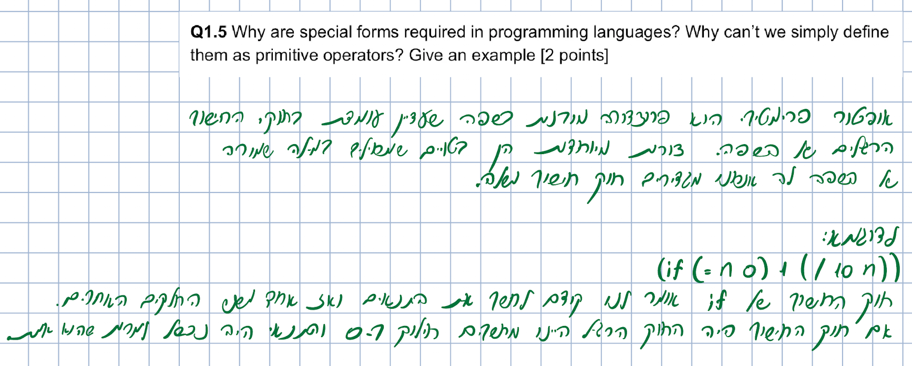

**Answer (typed):**

אופרטור פרימיטיבי הוא פרוצדורה מובנית בשפה שעדיין עומדת בחוקי החישוב הרגילים של השפה. צורות מיוחדות הן ביטויים שמתחילים במילה שמורה של השפה לה אנחנו מגדירים חוק חישוב משלה.

לדוגמא:

```scheme
(if (= n 0) 1 (/ 10 n))
```

חוק החישוב של if אומר לנו קודם לחשב את התנאים ואז אחד משני החלקים האחרים.

אם חוק החישוב היה החוק הרגיל היינו מחשבים חילוק ב-0 והתנאי היה נכשל למרות שהוא אמת.

### [2 points] Question 1.6

Is a function-body with multiple expressions required in a pure functional programming? In which type of languages is it useful? What about L3?

**Answer (handwritten):** see also `HW2Q1.pdf` / `HW2Q1.6.png`.

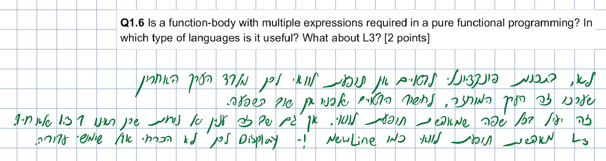

**Answer (typed):**

לא, בתכנות פונקציונלי לביטויים אין תופעות לוואי לכן מלבד הערך האחרון שערכו זה הערך המוחזר, לחישוב הביטויים שלפניו אין שום השפעה.

זה יעיל בכל שפה שמאפשרת תופעות לוואי. אך גם שם זה עניין של נוחות שכן ראינו ב1.3 שלא חייב.

‏L3 מאפשרת תופעות לוואי כמו newline ו-display לכן לא הכרחי אך שימושי עבורה.

### [2 points] Question 1.7

What is _lexical address_? Give an example which demonstrates this concept

**Answer (handwritten):** see also `HW2Q1.pdf` / `HW2Q1.7.png`.

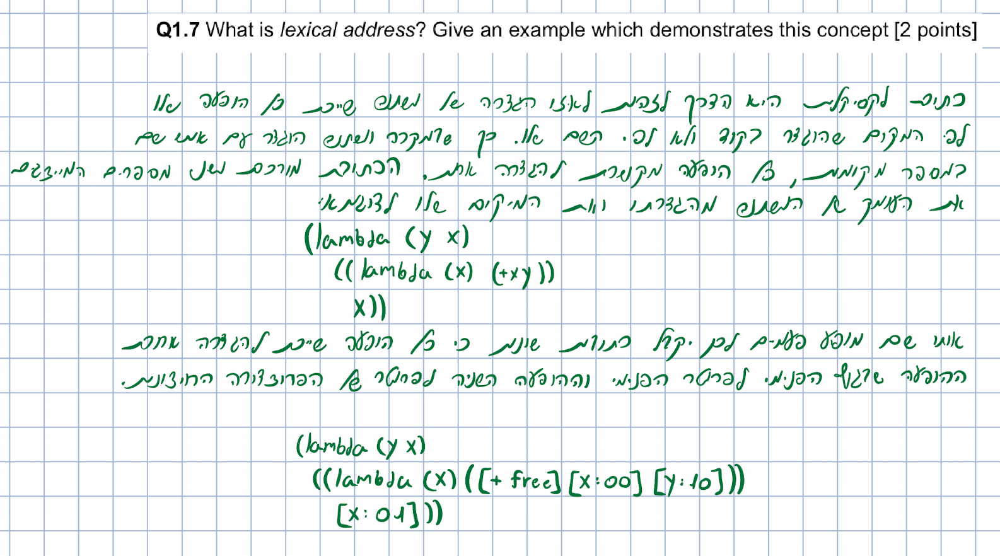

**Answer (typed):**

כתובת לקסיקלית היא הדרך לזהות לאיזו הגדרה של משתנה שייכת כל הופעה שלו לפי המקום שהוגדר בקוד ולא לפי השם שלו. כך שבמקרה ומשתנה הוגדר עם אותו שם במספר מקומות, כל הופעה מקושרת להגדרה אחת. הכתובת מורכבת משני מספרים המייצגים את העומק של המשתנה מהגדרתו ואת המיקום שלו. לדוגמא:

```scheme
(lambda (y x)
  ((lambda (x) (+ x y))
   x))
```

אותו שם מופיע פעמיים לכן יקבל כתובות שונות כי כל הופעה שייכת להגדרה אחרת. ההופעה שבגוף הפנימי לפרמטר הפנימי וההופעה השניה לפרמטר של הפרוצדורה החיצונית.

```scheme
(lambda (y x)
  ((lambda (x) ([+ free] [x : 0 0] [y : 1 0]))
   [x : 0 1]))
```

### [2 points] Question 1.8

In [practical session 5](https://bguppl.github.io/interpreters/practice_sessions/ps5.html), we deal with two representations of primitive operations: _PrimOp_ and _Closure_. List an advantage for each of the two methods.

**Answer (handwritten):** see also `HW2Q1.pdf` / `HW2Q1.8.png`.

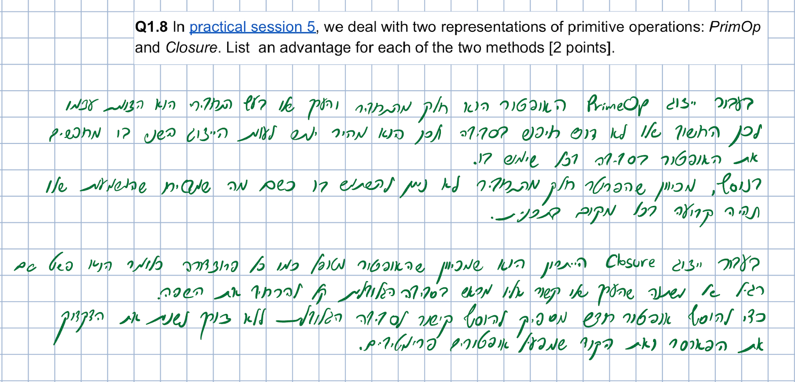

**Answer (typed):**

בעבור ייצוג PrimOp האופרטור הוא חלק מהתחביר והערך שלו בעץ התחבירי הוא הצומת עצמו לכן החישוב שלו לא דורש חיפוש בסביבה ולכן הוא מהיר יותר לעומת הייצוג השני בו מחפשים את האופרטור בסביבה בכל שימוש בו.

בנוסף, מכיוון שהפרמטר חלק מהתחביר לא ניתן להשתמש בו כשם מה שמבטיח שהמשמעות שלו תהיה קבועה בכל מקום בתכנית.

בעבור ייצוג Closure היתרון הוא שמכיוון שהאופרטור מטופל כמו כל פרוצדורה כלומר הוא בעצם שם רגיל של משתנה שהערך שלו קשור אליו מראש בסביבה הגלובלית קל להרחיב את השפה.

כדי להוסיף אופרטור חדש מספיק להוסיף קישור לסביבה הגלובלית ללא צורך לשנות את הדקדוק את הפארסר ואת הקוד שמפעיל אופרטורים פרימיטיביים.

### [4 points] Question 1.9

1. What are the reasons that would justify switching from applicative order to normal order evaluation? Give an example.
2. What are the reasons that would justify switching from normal order to applicative order evaluation? Give an example.

**Answer (handwritten):** see also `HW2Q1.pdf` / `HW2Q1.9.png`.

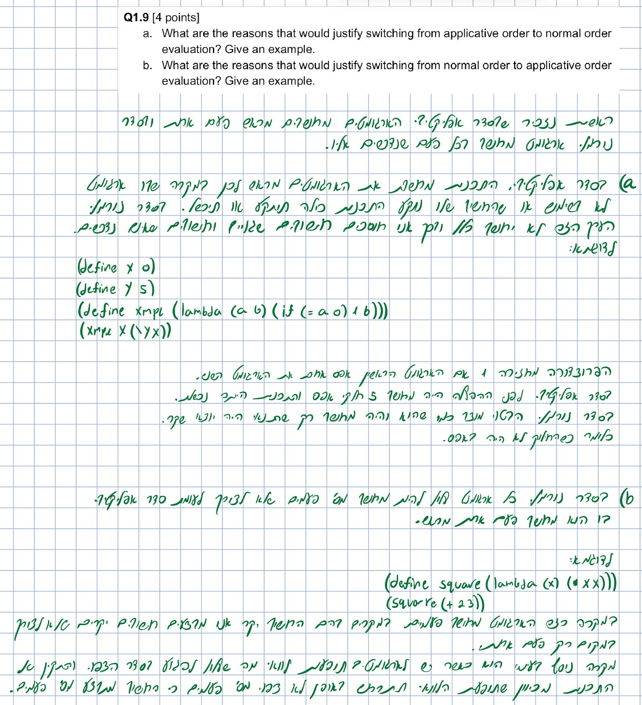

**Answer (typed):**

ראשית נזכיר שבסדר אפליקטיבי הארגומנטים מחושבים מראש פעם אחת ובסדר נורמלי ארגומנט מחושב בכל פעם שנדרשים אליו.

#### סעיף a

בסדר אפליקטיבי, התכנית מחשבת את הארגומנטים מראש לכן במקרה שבו ארגומנט לא בשימוש או שהחישוב שלו נתקע התכנית כולה תיתקע או תיכשל. בסדר נורמלי הערך הזה לא יחושב כלל וכך אנו חוסכים חישובים שגויים וחישובים שאינם נדרשים.

לדוגמא:

```scheme
(define x 0)
(define y 5)
(define xmpl (lambda (a b) (if (= a 0) 1 b)))
(xmpl x (/ y x))
```

הפרוצדורה מחזירה 1 אם הארגומנט הראשון אפס אחרת את הארגומנט השני.

בסדר אפליקטיבי. לפני ההפעלה היה מחושב 5 חלקי אפס והתכנית הייתה נכשלת.

בסדר נורמלי. הביטוי מוצב כמו שהוא והיה מחושב רק שהתנאי היה יוצא שקר. כלומר כשהחילוק לא היה באפס.

#### סעיף b

בסדר נורמלי כל ארגומנט עלול להיות מחושב מס' פעמים שלא לצורך לעומת סדר אפליקטיבי בו הוא מחושב פעם אחת מראש.

לדוגמא:

```scheme
(define square (lambda (x) (* x x)))
(square (+ 2 3))
```

במקרה כזה הארגומנט מחושב פעמיים. במקרים בהם החישוב יקר אנו מבצעים חישובים יקרים שלא לצורך במקום רק פעם אחת.

מקרה נוסף בעייתי הוא כאשר יש לארגומנטים תופעות לוואי מה שעלול לפגוע בסדר הצפוי והתקין של התכנית מכיוון שתופעת הלוואי תתרחש באופן לא צפוי. מס' פעמים כי החישוב מתבצע מס' פעמים.

### [6 points] Question 1.10

1. In L3, what is the role of the function valueToLitExp?
2. The valueToLitExp function is not needed in the normal evaluation strategy interpreter (L3-normal.ts). Why?
3. The valueToLitExp function is not needed in the environment-model interpreter. Why?

**Answer (handwritten):** see also `HW2Q1.pdf` / `HW2Q1.10.png`.

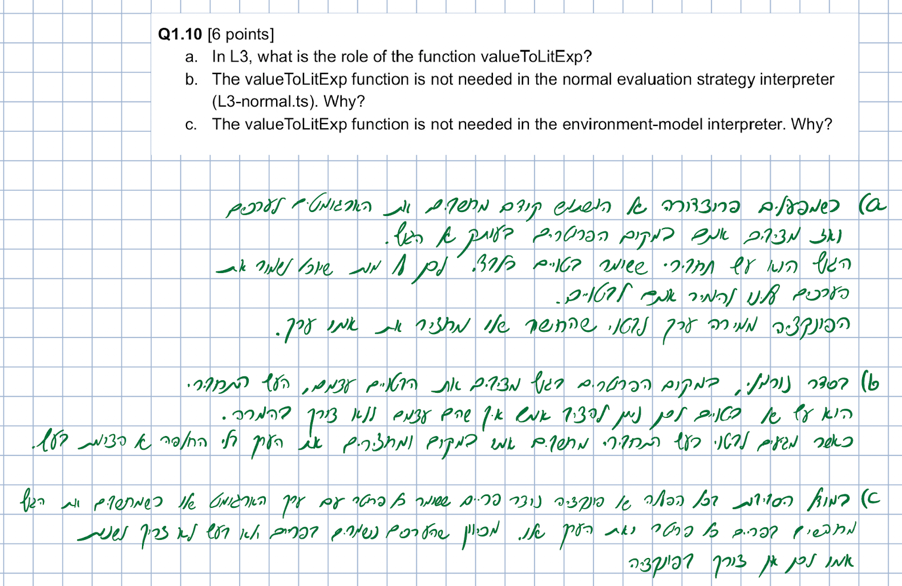

**Answer (typed):**

#### סעיף a

כשמפעילים פרוצדורה של המשתמש קודם מחשבים את הארגומנטים לערכים ואז מציבים אותם במקום הפרמטרים בעותק של הגוף.

הגוף הוא עץ תחבירי ששומר ביטויים בלבד. לכן על מנת שנוכל לשמור את הערכים עלינו להמיר אותם לביטויים.

הפונקציה ממירה ערך לביטוי שהחישוב שלו מחזיר את אותו ערך.

#### סעיף b

בסדר נורמלי, במקום הפרמטרים בגוף מציבים את הביטויים עצמם, העץ התחבירי הוא עץ של ביטויים לכן ניתן להציב אותם איך שהם עצמם וללא צורך בהמרה.

כאשר מגיעים לביטוי בעץ התחבירי מחשבים אותו במקום ומחזירים את הערך בלי החלפה של הצומת בעץ.

#### סעיף c

במודל הסביבות בכל הפעלה של פונקציה נוצר פריים ששומר כל פרמטר עם ערך הארגומנט שלו כשמחשבים את הגוף מחפשים בפריים כל פרמטר ואת הערך שלו. מכיוון שהערכים נשמרים בפריים ולא בגוף לא צריך לשנות אותו ולכן אין צורך בפונקציה

### [4 points] Question 1.11

1. Why is renaming not required in the environment model?
2. Is renaming required in the substitution model for a case where the term that is substituted is "closed", _i.e._, does not contain free variables? explain.

**Answer (handwritten):** see also `HW2Q1.pdf` / `HW2Q1.11.png`.

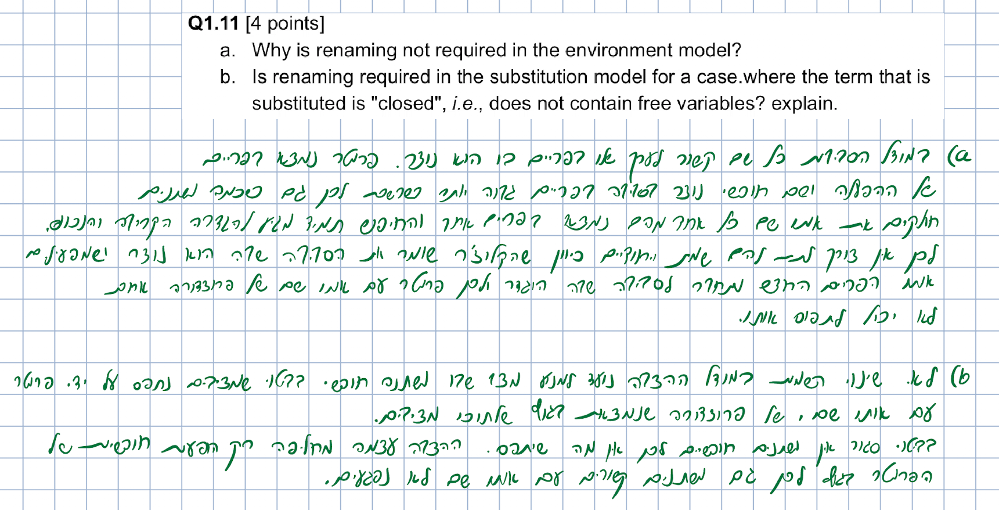

**Answer (typed):**

#### סעיף a

במודל הסביבות כל שם קשור לערך שלו בפריים בו הוא נוצר. פרמטר נמצא בפריים של ההפעלה ושם חופשי נוצר בסביבה בפריים גבוה יותר בשרשרת לכן גם כשכמה משתנים חולקים את אותו שם כל אחד מהם נמצא בפריים אחר והחיפוש תמיד מגיע להגדרה הקרובה והנכונה.

לכן אין צורך לתת להם שמות ייחודיים כיוון שהקלוז'ר שומר את הסביבה שבה הוא נוצר וכשמפעילים אותו הפריים החדש מתחבר לסביבה שבה הוגדר ולכן פרמטר עם אותו שם של פרוצדורה אחרת לא יכול לתפוס אותו.

#### סעיף b

לא. שינוי השמות במודל ההצבה נועד למנוע מצב שבו משתנה חופשי בביטוי שמציבים נתפס על ידי פרמטר עם אותו שם, של פרוצדורה שנמצאת בגוף שלתוכו מציבים.

בביטוי סגור אין משתנים חופשיים לכן אין מה שיתפס. ההצבה עצמה מחליפה רק הופעות חופשיות של הפרמטר בגוף לכן גם משתנים קשורים עם אותו שם לא נפגעים.
