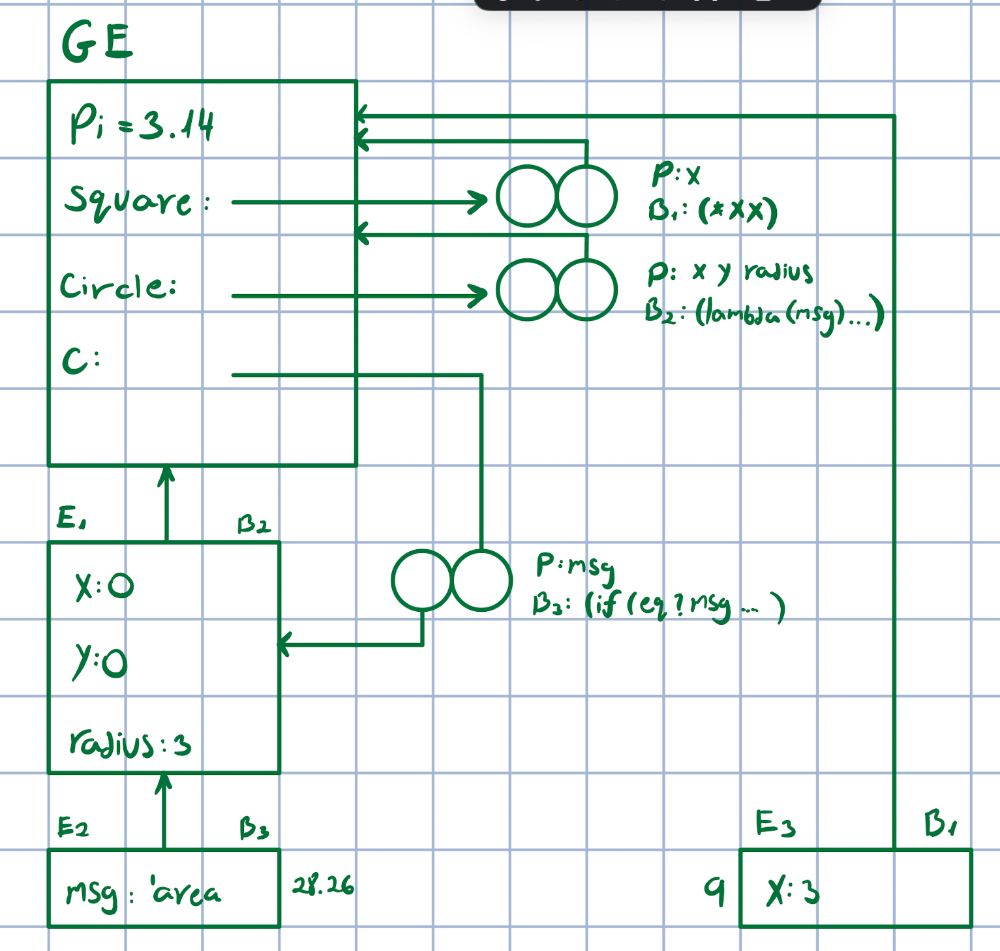

## Question 2: Adding Class to L3

### [10 points] Question 2.d

Given the following program:

```scheme
(define pi 3.14)
(define square (lambda (x) (* x x)))
(define circle
    (class (x y radius)
         (
          (area (lambda () (* (square radius) pi)))
          (perimeter (lambda () (* 2 pi radius)))
         )
    )
)
(define c (circle 0 0 3))
(c 'area)
```

- Convert the ClassExps to ProcExps (as defined in 2.c)
- List the expressions which are passed to the L3applicativeEval function during the computation of the program, (after the conversion), for the case of substitution model.
- Draw the environment diagram for the computation of the program (after the conversion), for the case of the environment model interpreter.

**Answer:**

#### 1) התכנית אחרי המרת המחלקה לפרוצדורה:

```scheme
(define pi 3.14)
(define square (lambda (x) (* x x)))
(define circle
  (lambda (x y radius)
    (lambda (msg)
      (if (eq? msg 'area)
          (* (square radius) pi)
          (if (eq? msg 'perimeter)
              (* 2 pi radius)
              'error)))))
(define c (circle 0 0 3))
(c 'area)
```

#### 2) הביטויים שמועברים לפונקציה L3applicativeEval במודל ההצבה, לפי הסדר:

```scheme
3.14
(lambda (x) (* x x))
(lambda (x y radius) (lambda (msg) (if (eq? msg 'area) (* (square radius) pi) (if (eq? msg 'perimeter) (* 2 pi radius) 'error))))
(circle 0 0 3)
circle
0
0
3
(lambda (msg__1) (if (eq? msg__1 'area) (* (square 3) pi) (if (eq? msg__1 'perimeter) (* 2 pi 3) 'error)))
(c 'area)
c
'area
(if (eq? 'area 'area) (* (square 3) pi) (if (eq? 'area 'perimeter) (* 2 pi 3) 'error))
(eq? 'area 'area)
eq?
'area
'area
(* (square 3) pi)
*
(square 3)
square
3
(* 3 3)
*
3
3
pi
```

ביטוי define עצמו לא מועבר לפונקציה, רק ביטוי הערך שלו. השם msg__1 נוצר משינוי השמות שהאינטרפרטר מבצע בהפעלה של הפרוצדורה circle‏, לפני ההצבה.

הערך של התכנית הוא 28.26.

#### 3) דיאגרמת הסביבות במודל הסביבות:

**Answer (handwritten):** see also `images/HW2Q2d.png`.



הגופים המלאים של הקלוז'רים שבדיאגרמה:

```scheme
; B1
(* x x)
; B2
(lambda (msg) (if (eq? msg 'area) (* (square radius) pi) (if (eq? msg 'perimeter) (* 2 pi radius) 'error)))
; B3
(if (eq? msg 'area) (* (square radius) pi) (if (eq? msg 'perimeter) (* 2 pi radius) 'error))
```
